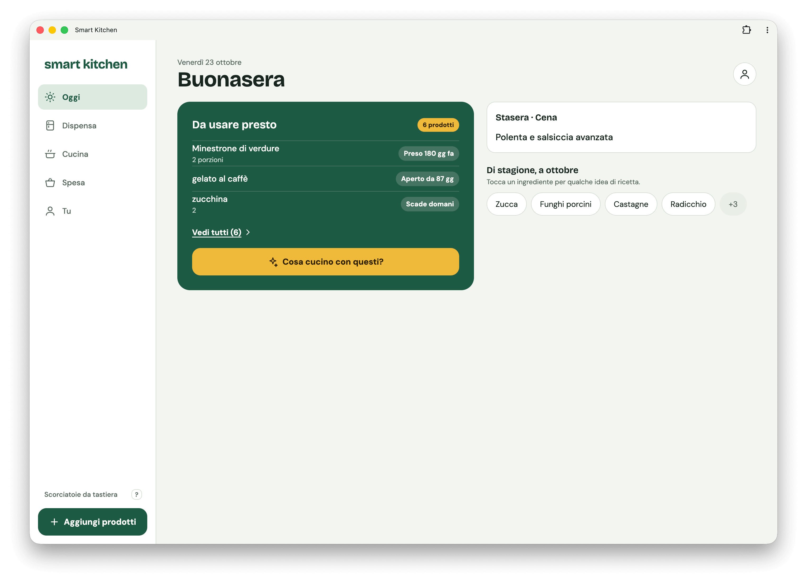
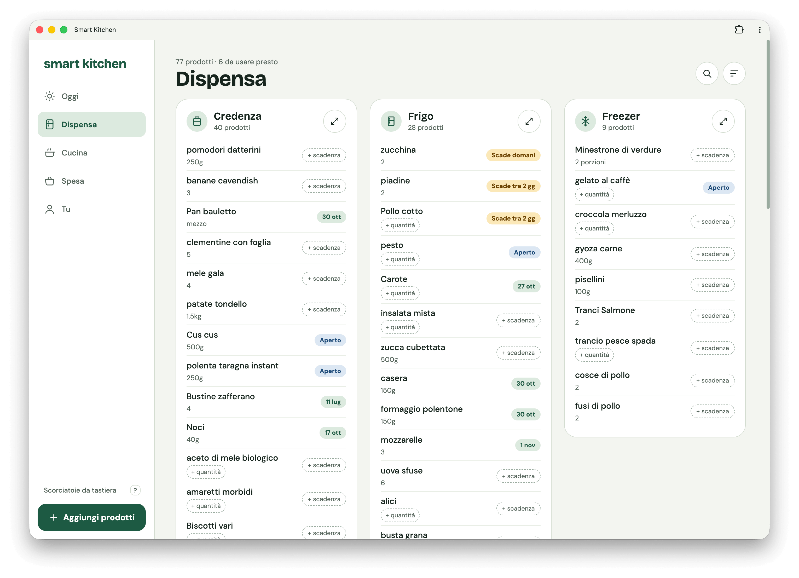
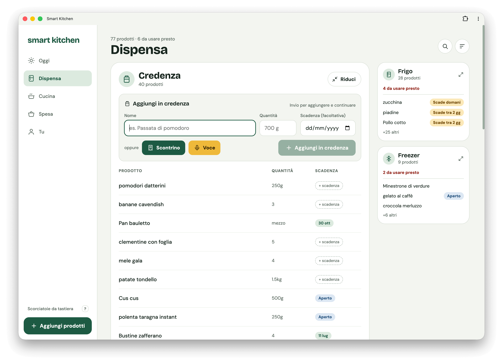
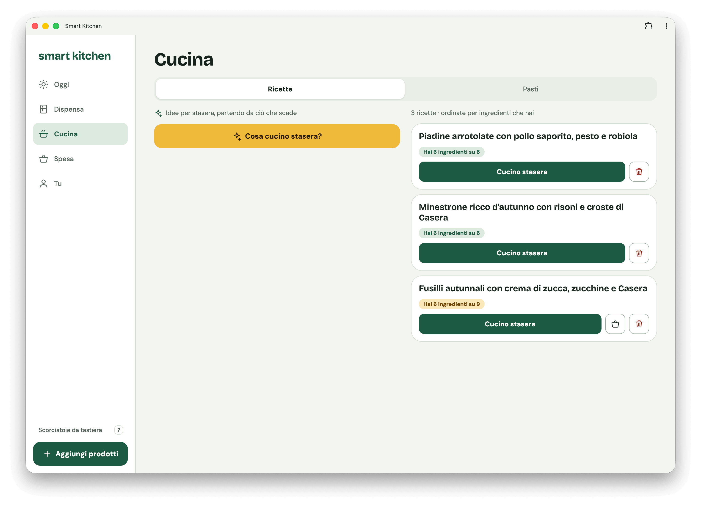
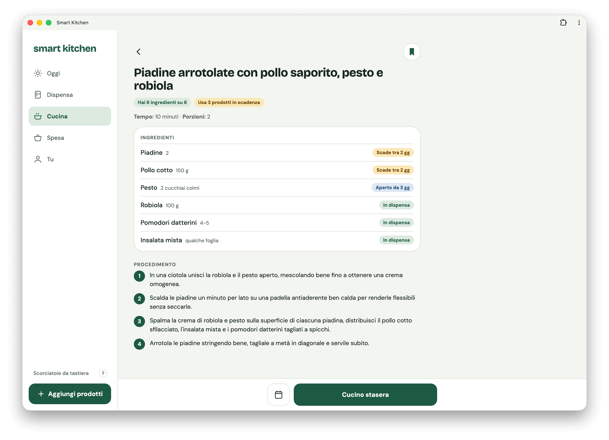
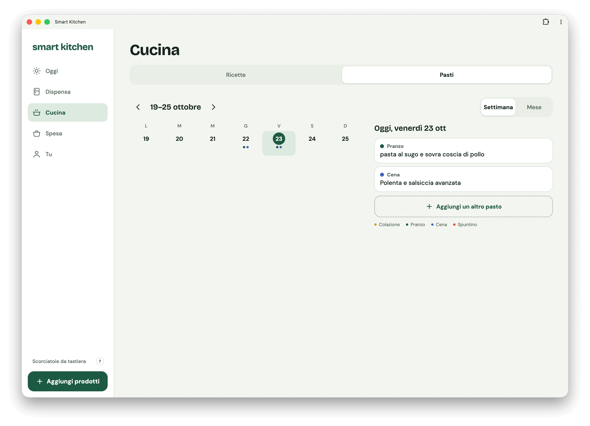
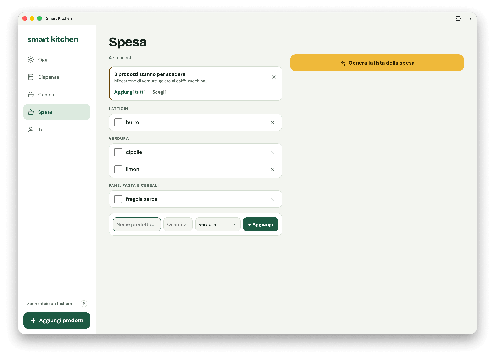
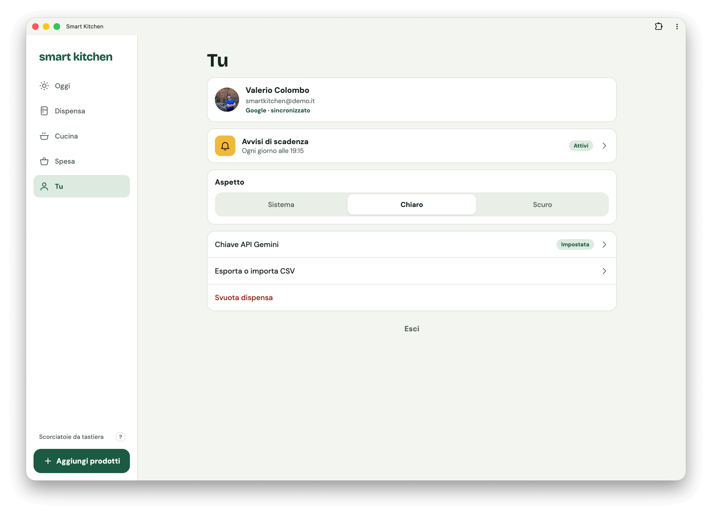
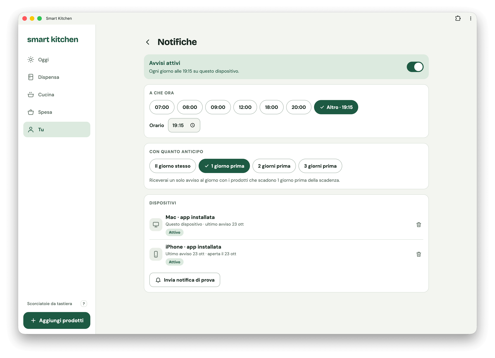

<p align="center">
  
</p>

<h1 align="center">smart kitchen</h1>

<p align="center">
  Gestione dispensa personale con sincronizzazione real-time tra dispositivi e suggerimenti AI stagionali.
</p>

È una **PWA** (Progressive Web App) ottimizzata sia per **desktop** che per **mobile**: si usa dal browser oppure si installa sul dispositivo (su iPhone con «Aggiungi a Home», su desktop e Android con «Installa app») e si apre a schermo intero come un'app nativa. Il layout si adatta allo schermo: sidebar e Dispensa a tre colonne su desktop, navigazione in basso e gesti di swipe su mobile. Funziona anche con le notifiche push: scadenze e promemoria dei pasti.

Stack: React 18 + Vite 5 + CSS Modules + Firebase (Auth, Firestore, Cloud Messaging, Functions) + Gemini AI.

## Screenshot

<p align="center">
  
  
  
  
  
  
  
  
  
</p>

## Funzionalità

- **Accesso con Google** e dati isolati per utente, sincronizzati in tempo reale tra i dispositivi (Firestore)
- **Oggi** — cosa usare presto, il pasto di stasera, gli ingredienti di stagione (un tocco genera ricette con quell'ingrediente)
- **Dispensa** — credenza / frigo / freezer con quantità e scadenza facoltative, stato «aperto», ricerca, ordinamento per priorità o per categoria; su desktop tre colonne con drag fra le card
- **Priorità intelligente** — stima dei giorni rimasti da scadenza, apertura e freschezza; l'analisi dei prodotti (categoria, durate di conservazione) gira in background con l'AI
- **Aggiunta rapida** — a mano, a voce, da foto o PDF dello scontrino, da CSV; schermata di verifica prima di confermare
- **Cucina** — ricette AI basate su dispensa e scadenze (con streaming), ricette salvate con «Hai X ingredienti su Y», pasti come registro e planner (pasti in programma con promemoria)
- **Spesa** — lista della spesa e idee AI stagionali integrate con la dispensa
- **Notifiche push** (Cloud Functions): avviso di scadenza con orario e anticipo a scelta, promemoria dei pasti in programma e «pianifica la cena», con un centro notifiche nell'app (campanella su mobile, pannello su desktop)
- **Scorciatoie da tastiera**, tema chiaro/scuro, PWA installabile
- **Modalità demo** per le preview, senza login né Firebase

Le funzioni AI usano la **chiave Gemini dell'utente** (non c'è una chiave del developer), inserita in Tu › Chiave API Gemini: viene salvata in `localStorage` e sincronizzata sull'account.

## Prerequisiti

- Node.js (versione in `.nvmrc`)
- Progetto Firebase con Authentication (provider Google) e Firestore abilitati
- Piano Blaze di Firebase, solo se vuoi le notifiche push (Cloud Functions schedulate)
- Chiave Gemini (opzionale, per le funzioni AI)

## Setup

1. Copia `.env.example` in `.env` e compila le variabili `VITE_FIREBASE_*` dal tuo progetto Firebase
   (le istruzioni, compresa la chiave VAPID per le push, sono nel file).

2. Installa le dipendenze e avvia:

```bash
npm install
npm run dev
```

Per provare l'app senza Firebase: `VITE_MOCK_MODE=true` nel `.env` attiva la [modalità demo](docs/wiki/Modalità%20demo.md).

## Comandi

```bash
npm run dev      # dev server
npm run build    # build di produzione in dist/
npm run preview  # anteprima della build
```

## Deploy

Il client è una build statica (`dist/`), pubblicabile su Vercel, Firebase Hosting o simili. Su Vercel ogni branch diverso da `master`
usa la modalità demo; in produzione non è mai attiva.

Per le notifiche l'ordine è **Functions → client → regole**:

```bash
cd functions && npm install && cd ..
firebase deploy --only functions
```

Poi pubblica il client e infine le regole Firestore. Eccezione: quando le regole aggiungono campi che il client nuovo scrive (come `meals` per i promemoria dei pasti), pubblicale prima del client; i dettagli sono in [`docs/firestore-rules.md`](docs/firestore-rules.md).

## Firestore Security Rules

Le regole vanno applicate a mano dalla Firebase Console (Firestore Database → Rules → Publish): il testo completo e aggiornato è in
[`docs/firestore-rules.md`](docs/firestore-rules.md). Ogni utente legge e scrive solo i propri documenti `/users/{uid}/...`; tutto il resto è negato.

## Documentazione

- [Wiki](https://github.com/colombodevdesign/smart-kitchen/wiki) — guida alle funzionalità (sorgenti in [`docs/wiki/`](docs/wiki))
- [`CLAUDE.md`](CLAUDE.md) — architettura, modello dati e convenzioni del codice
- [`docs/`](docs) — design brief, note di implementazione, regole Firestore

## Licenza

[MIT](LICENSE)
